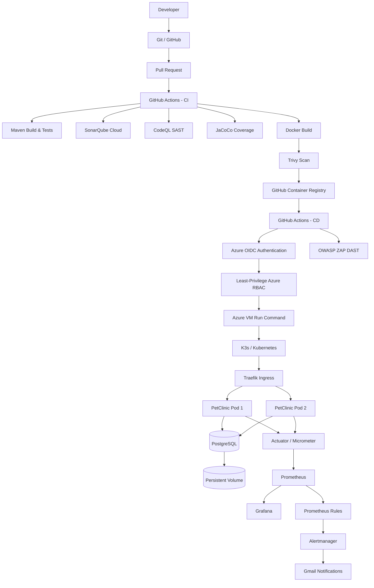

# Spring PetClinic DevSecOps on Microsoft Azure

[](https://github.com/raghadkhedhiri/spring-petclinic-devops/actions/workflows/ci.yml)
[](https://github.com/raghadkhedhiri/spring-petclinic-devops/actions/workflows/cd.yml)
[](https://github.com/raghadkhedhiri/spring-petclinic-devops/actions/workflows/dast.yml)

A complete DevSecOps implementation around the Spring PetClinic application, covering continuous integration, software quality, security testing, containerization, Infrastructure as Code, Kubernetes deployment, continuous delivery, monitoring and alerting on Microsoft Azure.

This repository is based on the official [Spring PetClinic](https://github.com/spring-projects/spring-petclinic) application. The main objective of this project is not to redesign the PetClinic business application, but to build a secure, automated and reproducible Cloud/DevSecOps delivery platform around it.

---

## Project Context

This project was developed as part of an engineering internship at **ESPRIT**.

**Engineering field:** Software Architecture Engineering (SAE)  
**Internship period:** 09 July 2026 – 10 September 2026  
**Host organization:** ESPRIT  
**Author:** Raghad Khedhiri

The core DevOps and Cloud platform was developed progressively during the internship. Monitoring, alerting and final hardening were completed as a technical continuation of the project.

---

## Project Objectives

The project addresses the following question:

> How can the build, validation, security, deployment and monitoring lifecycle of a Spring Boot application be automated in a secure and reproducible Cloud environment?

The implementation covers:

- Continuous Integration with GitHub Actions
- Automated Maven build and tests
- SonarQube Cloud quality analysis
- CodeQL static application security testing
- JaCoCo test coverage enforcement
- Docker containerization
- Trivy container vulnerability scanning
- GitHub Container Registry image publishing
- Azure infrastructure provisioning with Terraform
- K3s installation and configuration with Ansible
- Kubernetes application and database deployment
- Secure Continuous Deployment using Azure OIDC
- Least-privilege Azure RBAC
- OWASP ZAP dynamic application security testing
- Prometheus metrics collection
- Grafana dashboards
- Alertmanager incident routing
- Gmail incident notifications

---

# Architecture



---

# Technology Stack

| Area | Technology |
|---|---|
| Application | Spring Boot |
| Language target | Java 17 |
| CI build JDK | Eclipse Temurin JDK 21 |
| Build | Maven Wrapper |
| Database | PostgreSQL 18.4 |
| Local development DB | H2 / PostgreSQL |
| Containerization | Docker |
| Container Registry | GitHub Container Registry |
| CI/CD | GitHub Actions |
| Code Quality | SonarQube Cloud |
| SAST | GitHub CodeQL |
| Test Coverage | JaCoCo |
| Container Security | Trivy |
| DAST | OWASP ZAP |
| Cloud | Microsoft Azure |
| Infrastructure as Code | Terraform |
| Configuration Management | Ansible |
| Kubernetes Distribution | K3s |
| Kubernetes Ingress | Traefik |
| Package Management | Helm |
| Metrics | Spring Boot Actuator + Micrometer |
| Monitoring | Prometheus |
| Visualization | Grafana |
| Alerting | Alertmanager |
| Notifications | Gmail SMTP |

---

# Repository Structure

```text
spring-petclinic-devops/
│
├── .github/
│   └── workflows/
│       ├── ci.yml
│       ├── cd.yml
│       ├── dast.yml
│       └── deploy-and-test-cluster.yml
│
├── infra/
│   ├── terraform/
│   │   ├── provider.tf
│   │   ├── versions.tf
│   │   ├── variables.tf
│   │   ├── network.tf
│   │   ├── connectivity.tf
│   │   ├── security.tf
│   │   ├── vm.tf
│   │   └── cd-identity.tf
│   │
│   └── ansible/
│       ├── inventory.ini
│       ├── requirements.yml
│       ├── site.yml
│       └── roles/
│           ├── k3s/
│           ├── helm/
│           └── monitoring/
│
├── k8s/
│   ├── base/
│   │   ├── namespace.yaml
│   │   ├── petclinic-configmap.yaml
│   │   ├── petclinic-deployment.yaml
│   │   ├── petclinic-service.yaml
│   │   ├── petclinic-metrics-service.yaml
│   │   ├── petclinic-ingress.yaml
│   │   ├── postgres-service.yaml
│   │   ├── postgres-statefulset.yaml
│   │   ├── postgres-init-configmap.yaml
│   │   └── postgres-init-job.yaml
│   │
│   └── monitoring/
│       ├── values.yaml
│       ├── petclinic-servicemonitor.yaml
│       ├── petclinic-prometheusrule.yaml
│       ├── petclinic-dashboard.yaml
│       └── petclinic-alertmanagerconfig.yaml.tpl
│
├── scripts/
│   ├── package-cd-manifests.sh
│   └── update-ssh-cidr.sh
│
├── src/
├── Dockerfile
├── docker-compose.yml
├── .env.example
├── pom.xml
└── README.md
```

---

# Application

Spring PetClinic is a Spring Boot application providing a realistic application layer with:

- Web controllers
- persistence
- relational database access
- Maven tests
- multiple application endpoints
- database initialization
- Spring Boot Actuator

Using an existing application allowed the project to focus on DevOps, Cloud infrastructure, security, deployment automation and observability rather than implementing a new business application.

---

# Java and Build Configuration

The Maven project targets:

```xml
<java.version>17</java.version>
```

The CI pipeline and Docker build use **Eclipse Temurin JDK 21** to build the Java 17-targeted application.

Run the complete Maven validation locally with:

```bash
./mvnw -B verify
```

The `verify` lifecycle includes the project's automated tests and the JaCoCo coverage verification.

---

# Test Coverage with JaCoCo

JaCoCo is configured directly in `pom.xml`.

The project enforces a minimum bundle line coverage ratio of:

```text
80%
```

The Maven build fails when the configured minimum coverage requirement is not respected.

This is a quality gate, not a statement that the application always has exactly 80% coverage.

---

# Local Execution with H2

For a quick local validation, PetClinic can run using its default embedded H2 database.

```bash
git clone https://github.com/raghadkhedhiri/spring-petclinic-devops.git
cd spring-petclinic-devops

./mvnw spring-boot:run
```

Then open:

```text
http://localhost:8080
```

H2 is useful for quick development and validation without requiring an external database.

---

# Local PostgreSQL Environment

For a more production-like local environment, PostgreSQL is available through Docker Compose.

Create a local environment file:

```bash
cp .env.example .env
```

Edit `.env`:

```dotenv
POSTGRES_DB=petclinic
POSTGRES_USER=petclinic
POSTGRES_PASSWORD=CHANGE_ME
```

The real `.env` file must never be committed.

Build the application image:

```bash
docker build -t petclinic-app:1.3 .
```

Start the application and database:

```bash
docker compose up -d
```

Check the containers:

```bash
docker compose ps
```

Access PetClinic at:

```text
http://localhost:8080
```

Stop the environment:

```bash
docker compose down
```

---

# Docker Image

The project contains a multi-stage `Dockerfile`.

Build stage:

```text
eclipse-temurin:21-jdk
```

Runtime stage:

```text
eclipse-temurin:21-jre-ubi10-minimal
```

The final container exposes:

```text
8080
```

Build manually with:

```bash
docker build -t petclinic-app:local .
```

---

# Continuous Integration

The main CI workflow is:

```text
.github/workflows/ci.yml
```

Workflow name:

```text
PetClinic CI
```

It runs on:

```text
pull_request -> main
push -> main
```

This provides two complementary validation levels:

```text
Feature branch
     |
     v
Pull Request
     |
     v
CI validation before merge
     |
     v
Merge into main
     |
     v
CI validation of final main state
```

---

## Maven Build, Tests and SonarQube

The `build-and-test` job runs:

```bash
./mvnw -B verify \
  org.sonarsource.scanner.maven:sonar-maven-plugin:sonar \
  -Dsonar.projectKey=raghadkhedhiri_spring-petclinic-devops
```

The SonarQube token is provided through:

```text
SONAR_TOKEN
```

as a GitHub Actions secret.

---

# Static Application Security Testing

## CodeQL

GitHub CodeQL is executed in a dedicated CI job:

```text
SAST - CodeQL
```

The workflow:

1. checks out the repository;
2. configures Java;
3. initializes CodeQL;
4. builds the application;
5. performs semantic security analysis.

The configured language is:

```text
java-kotlin
```

---

# Container Security

The CI pipeline builds a Docker image and scans it with **Trivy**.

The scan targets:

```text
OS vulnerabilities
Library vulnerabilities
```

The build fails for detected vulnerabilities with severity:

```text
HIGH
CRITICAL
```

Relevant configuration:

```yaml
exit-code: '1'
severity: 'HIGH,CRITICAL'
vuln-type: 'os,library'
```

---

# GitHub Container Registry

Images are published to:

```text
ghcr.io/raghadkhedhiri/petclinic-app
```

Image publication only happens on a successful push workflow.

Two tags are produced:

```text
<full-git-commit-sha>
latest
```

Example:

```text
ghcr.io/raghadkhedhiri/petclinic-app:<COMMIT_SHA>
```

Using the exact commit SHA provides traceability between source code, CI validation and the image deployed to Kubernetes.

---

# Kubernetes Manifest Validation

A dedicated workflow validates the application manifests:

```text
.github/workflows/deploy-and-test-cluster.yml
```

Workflow name:

```text
Validate PetClinic Kubernetes Manifests
```

It creates a temporary Kubernetes cluster using KinD and executes server-side dry-run validation of the application manifests.

This provides an additional validation layer before deployment to the real K3s cluster.

---

# Azure Infrastructure

Azure infrastructure is defined under:

```text
infra/terraform/
```

Terraform manages:

- Resource Group
- Virtual Network
- Subnet
- Network Interface
- Network Security Group
- Static Public IP
- Ubuntu Linux Virtual Machine
- GitHub CD managed identity
- Azure federated identity credential
- custom CD RBAC role
- role assignment

---

## Terraform Versions

Required Terraform version:

```text
>= 1.15.0, < 2.0.0
```

AzureRM provider:

```text
~> 4.0
```

---

# Azure Network

The Terraform network uses:

```text
VNet:   10.10.0.0/16
Subnet: 10.10.1.0/24
```

Inbound NSG access is intentionally restricted.

### SSH

```text
TCP/22
```

SSH is allowed only from:

```text
admin_cidr
```

which should contain the administrator's current public IPv4 address as `/32`.

### HTTP

The public application is exposed through:

```text
TCP/80
```

Traffic reaches:

```text
Internet
   |
   v
Azure Public IP
   |
   v
Network Security Group
   |
   v
Azure VM
   |
   v
K3s Traefik
   |
   v
PetClinic Ingress
   |
   v
PetClinic Service
   |
   v
PetClinic Pods :8080
```

---

# Terraform Configuration

Create a local:

```text
infra/terraform/terraform.tfvars
```

Example:

```hcl
admin_cidr         = "YOUR_PUBLIC_IP/32"
ssh_public_key_path = "~/.ssh/id_rsa.pub"

# Optional overrides:
# location          = "polandcentral"
# vm_size           = "Standard_B4as_v2"
# admin_username    = "azureuser"
# availability_zone = "2"
```

Do not commit `terraform.tfvars` if it contains environment-specific or sensitive information.

Authenticate with Azure:

```bash
az login
```

Initialize Terraform:

```bash
terraform -chdir=infra/terraform init
```

Validate formatting:

```bash
terraform -chdir=infra/terraform fmt -check
```

Validate configuration:

```bash
terraform -chdir=infra/terraform validate
```

Generate a plan:

```bash
terraform -chdir=infra/terraform plan
```

Review the plan carefully before applying:

```bash
terraform -chdir=infra/terraform apply
```

---

# Dynamic SSH CIDR Helper

The repository contains:

```text
scripts/update-ssh-cidr.sh
```

The script:

- detects the current public IPv4 address;
- updates the local `admin_cidr`;
- executes `terraform fmt -check`;
- executes `terraform validate`;
- creates a Terraform plan;
- displays the plan for manual review.

Important:

> The script does **not** execute `terraform apply`.

Run:

```bash
./scripts/update-ssh-cidr.sh
```

The resulting plan must be reviewed before any infrastructure change is applied.

---

# Azure Cost Management

The project was implemented using an Azure for Students subscription.

Cloud resources were monitored through Azure Cost Management during development.

The VM is the main cost-generating resource. When the environment is not required, the VM can be stopped and **deallocated** to preserve student credits.

This is an operational cost-control practice and is not presented as an automated Terraform feature.

---

# Configuration Management with Ansible

Ansible configures the Azure VM after infrastructure provisioning.

Main playbook:

```text
infra/ansible/site.yml
```

It applies three roles:

```text
k3s
helm
monitoring
```

---

# K3s

The K3s version is pinned to:

```text
v1.36.3+k3s1
```

The Ansible role performs installation, configuration and verification of the K3s server.

The project currently uses a **single K3s server node**.

---

# Helm

Helm installation is also automated with Ansible.

Pinned version:

```text
v4.2.4
```

The binary integrity is verified using a configured SHA-256 checksum.

---

# Ansible Usage

Update:

```text
infra/ansible/inventory.ini
```

for the target Azure VM.

Example:

```ini
[k3s_server]
petclinic-vm ansible_host=<AZURE_PUBLIC_IP> ansible_user=azureuser ansible_ssh_private_key_file=~/.ssh/id_rsa
```

Never commit private SSH keys.

Install required Ansible collections if necessary:

```bash
ansible-galaxy collection install -r infra/ansible/requirements.yml
```

Validate the playbook:

```bash
ansible-playbook \
  -i infra/ansible/inventory.ini \
  infra/ansible/site.yml \
  --syntax-check
```

Apply:

```bash
ansible-playbook \
  -i infra/ansible/inventory.ini \
  infra/ansible/site.yml
```

Ansible roles are designed to be rerunnable and idempotent where applicable.

---

# Kubernetes Architecture

The project deployment manifests are located in:

```text
k8s/base/
```

The application runs in:

```text
namespace: petclinic
```

---

## PetClinic Deployment

PetClinic is configured with:

```text
replicas: 2
```

Container ports:

```text
8080 -> application HTTP
9090 -> management / metrics
```

Resource configuration:

```text
requests:
  CPU:    250m
  Memory: 512Mi

limits:
  CPU:    1
  Memory: 1Gi
```

Health checks include:

```text
startupProbe
readinessProbe
livenessProbe
```

through:

```text
/readyz
/livez
```

---

# PetClinic Service and Ingress

PetClinic uses an internal Kubernetes:

```text
ClusterIP Service
```

Mapping:

```text
Service port 80
     |
     v
Container port 8080
```

Traefik is used as the K3s Ingress Controller.

The application path is:

```text
/
```

The PetClinic Service also enables Traefik sticky-session cookies.

---

# PostgreSQL on Kubernetes

PostgreSQL runs as a:

```text
StatefulSet
```

with:

```text
replicas: 1
```

Image:

```text
postgres:18.4
```

PostgreSQL includes:

```text
startupProbe
readinessProbe
livenessProbe
```

using `pg_isready`.

---

# Persistent Storage

PostgreSQL requests:

```text
5Gi
```

through a:

```text
PersistentVolumeClaim
```

using the K3s:

```text
local-path
```

storage class.

The PVC provides persistent storage for PostgreSQL data across Pod recreation.

---

# Database Initialization

Database schema and seed data are handled by a dedicated Kubernetes initialization job:

```text
postgres-init
```

The initialization logic is idempotent.

The job:

1. applies the PostgreSQL schema;
2. checks whether application data already exists;
3. loads seed data only when required.

PetClinic itself is configured in Kubernetes with:

```text
SPRING_SQL_INIT_MODE=never
```

so database initialization responsibility remains separated from the application Pods.

---

# Kubernetes Secrets

Database credentials are not stored directly in the committed application manifests.

The Kubernetes deployment expects:

```text
postgres-secret
```

with the following keys:

```text
database
username
password
```

Example creation:

```bash
sudo k3s kubectl create namespace petclinic
```

```bash
sudo k3s kubectl -n petclinic create secret generic postgres-secret \
  --from-literal=database=petclinic \
  --from-literal=username=petclinic \
  --from-literal=password='CHANGE_ME'
```

Never commit the real database password.

---

# Continuous Deployment

CD workflow:

```text
.github/workflows/cd.yml
```

Workflow name:

```text
PetClinic CD
```

It starts only after a successful:

```text
PetClinic CI
```

execution on `main`.

The CD deploys the **exact commit SHA validated by CI**.

---

# Azure OIDC Authentication

GitHub Actions authenticates to Azure using **OpenID Connect (OIDC)**.

This eliminates the need to store a long-lived Azure client secret in GitHub.

GitHub Actions requests a short-lived identity token, which Azure validates through a federated identity credential.

Required GitHub repository variables:

```text
AZURE_CLIENT_ID
AZURE_TENANT_ID
AZURE_SUBSCRIPTION_ID
```

GitHub workflow permissions include:

```yaml
id-token: write
contents: read
```

---

# Least-Privilege Azure RBAC

Terraform creates a dedicated managed identity for CD.

The custom role is limited to:

```text
Microsoft.Compute/virtualMachines/read
Microsoft.Compute/virtualMachines/runCommand/action
```

The role is assigned to the target Azure VM.

The CD workflow therefore does not require broad subscription-level administrative privileges.

---

# Versioned Kubernetes Deployment

Before deployment, the CD workflow runs:

```text
scripts/package-cd-manifests.sh
```

The script accepts only an image reference matching:

```text
ghcr.io/<owner>/petclinic-app:<40-character-git-sha>
```

It creates a temporary deployment bundle containing the versioned application manifests and replaces the deployment image with the exact CI commit SHA.

This prevents the remote VM from depending on an arbitrary or stale local Git checkout.

---

# Deployment Verification

Azure Run Command executes the deployment remotely on the K3s VM.

The workflow:

1. applies the namespace;
2. applies the packaged manifests;
3. waits for the PetClinic rollout;
4. reads the deployed image;
5. compares it to the expected CI SHA;
6. checks running PetClinic Pods;
7. performs an HTTP application test;
8. emits:

```text
PETCLINIC_DEPLOYMENT_OK
```

GitHub Actions verifies this marker before considering CD successful.

---

# Dynamic Application Security Testing

DAST workflow:

```text
.github/workflows/dast.yml
```

Workflow name:

```text
PetClinic DAST
```

It runs after a successful CD deployment and can also be launched manually.

Before scanning, it validates that the deployed application is reachable.

The target URL is provided using:

```text
PETCLINIC_BASE_URL
```

as a GitHub repository variable.

---

## OWASP ZAP

The project uses:

```text
OWASP ZAP Baseline Scan
```

with ZAP:

```text
2.17.0
```

The container image is pinned by digest.

The generated report is stored as a GitHub Actions artifact:

```text
zap-baseline-report
```

The baseline scan is currently configured as:

```yaml
fail_action: false
```

This means DAST currently establishes and reports a security baseline without automatically blocking the delivery pipeline for every detected warning.

A successful workflow therefore means that the scan executed correctly, **not** that the application has zero security findings.

---

# Application Security Hardening

The application includes Spring Security configuration with CSRF protection enabled.

Custom HTTP security headers include:

```text
Content-Security-Policy
X-Frame-Options: DENY
X-Content-Type-Options: nosniff
```

The Content Security Policy restricts scripts, images, fonts, framing and form submission to reduce common Web security risks.

---

# Observability

Spring PetClinic uses:

```text
Spring Boot Actuator
Micrometer Prometheus Registry
```

Application traffic uses:

```text
8080
```

while management metrics use a dedicated port:

```text
9090
```

Only the following management endpoints are exposed:

```text
health
prometheus
```

Prometheus metrics are available internally through:

```text
/actuator/prometheus
```

---

# Metrics Service

Kubernetes exposes metrics through the internal service:

```text
petclinic-metrics
```

It is a:

```text
ClusterIP
```

and is not intentionally exposed to the public Internet.

---

# Prometheus ServiceMonitor

The PetClinic `ServiceMonitor` scrapes:

```text
/actuator/prometheus
```

every:

```text
30 seconds
```

with a:

```text
10 second
```

scrape timeout.

---

# Monitoring Stack

The monitoring stack is deployed using:

```text
Ansible
Helm
kube-prometheus-stack
```

Helm chart:

```text
kube-prometheus-stack
```

Pinned chart version:

```text
89.2.4
```

Monitoring namespace:

```text
monitoring
```

---

# Prometheus

Prometheus uses an internal:

```text
ClusterIP
```

service.

Retention:

```text
10 days
```

Maximum retention size:

```text
8 GB
```

Persistent storage:

```text
10 Gi
```

Prometheus is configured to discover PetClinic `ServiceMonitor` and `PrometheusRule` resources from both:

```text
monitoring
petclinic
```

namespaces.

---

# Grafana

Grafana is enabled through `kube-prometheus-stack`.

Service type:

```text
ClusterIP
```

Public ingress:

```text
disabled
```

Persistent storage:

```text
2 Gi
```

The administrator password is stored in a Kubernetes Secret:

```text
petclinic-grafana-admin
```

and is not stored directly in the repository.

The required environment variable when initially creating the Secret is:

```text
GRAFANA_ADMIN_PASSWORD
```

---

# PetClinic Grafana Dashboard

A version-controlled Grafana dashboard is provided in:

```text
k8s/monitoring/petclinic-dashboard.yaml
```

The dashboard includes:

```text
PetClinic metrics target state
Available PetClinic replicas
HTTP request rate
Average HTTP latency
JVM heap memory
PetClinic process CPU
Container restarts
```

The monitoring validation confirmed the PetClinic metrics target as:

```text
UP
```

with:

```text
2
```

available application replicas.

---

# Prometheus Alert Rules

The project defines three application-specific alerts.

## PetClinicTargetDown

Severity:

```text
critical
```

Triggered when Prometheus cannot scrape the PetClinic metrics target for more than:

```text
2 minutes
```

## PetClinicDeploymentUnavailable

Severity:

```text
warning
```

Triggered when available deployment replicas are lower than the expected replica count for:

```text
5 minutes
```

## PetClinicContainerRestarting

Severity:

```text
warning
```

Triggered when a PetClinic container restarts during the monitored interval.

---

# Alertmanager

Alertmanager is enabled with:

```text
1 Gi
```

persistent storage.

It remains accessible through an internal:

```text
ClusterIP
```

service.

PetClinic uses a dedicated:

```text
AlertmanagerConfig
```

resource.

Alerts routed to Gmail are filtered to:

```text
warning
critical
```

This avoids routing unrelated informational monitoring noise.

---

# Gmail Notifications

Alertmanager sends incident notifications through:

```text
smtp.gmail.com:587
```

with TLS required.

Configuration supports both:

```text
FIRING
RESOLVED
```

notifications.

The Gmail application password is stored in a Kubernetes Secret:

```text
petclinic-gmail-smtp
```

The password is never stored directly in Git.

When Gmail alerting is enabled, the following environment variables are used:

```text
PETCLINIC_ALERT_EMAIL
PETCLINIC_GMAIL_APP_PASSWORD
```

Example:

```bash
export PETCLINIC_ALERT_EMAIL="your-address@example.com"
export PETCLINIC_GMAIL_APP_PASSWORD="YOUR_APP_PASSWORD"
```

Do not place these values in committed files.

Enable the email tasks when executing Ansible with the appropriate monitoring configuration, for example:

```bash
ansible-playbook \
  -i infra/ansible/inventory.ini \
  infra/ansible/site.yml \
  -e monitoring_email_alerts_enabled=true
```

---

# Alerting Validation

The Prometheus → Alertmanager → Gmail chain was validated end-to-end using a temporary synthetic Prometheus rule.

The test did **not** intentionally create a real PetClinic outage.

Validation confirmed:

```text
Prometheus alert -> FIRING
Alertmanager     -> active alert
Gmail            -> FIRING email received

Synthetic rule removed

Prometheus alert -> resolved
Alertmanager     -> resolution
Gmail            -> RESOLVED email received
```

This verifies the complete notification path without disrupting the production-like PetClinic workload.

---

# Monitoring Security

Prometheus, Grafana and Alertmanager are configured as internal Kubernetes services.

No permanent Azure public inbound rules are required for the monitoring interfaces.

This minimizes the public attack surface of the monitoring stack.

---

# GitHub Repository Configuration

The CI/CD implementation expects the following GitHub configuration.

## Secrets

```text
SONAR_TOKEN
POSTGRES_PASSWORD
```

## Repository Variables

```text
AZURE_CLIENT_ID
AZURE_TENANT_ID
AZURE_SUBSCRIPTION_ID
PETCLINIC_BASE_URL
```

Sensitive values must be stored using GitHub Secrets or Kubernetes Secrets, not committed into source control.

---

# DevSecOps Pipeline

The complete automated path is:

```text
Feature branch
      |
      v
Pull Request
      |
      v
PetClinic CI
      |
      +--> Maven verify
      +--> JaCoCo
      +--> SonarQube
      +--> CodeQL
      +--> Docker Build
      +--> Trivy
      |
      v
Merge to main
      |
      v
PetClinic CI
      |
      v
GHCR image tagged with commit SHA
      |
      v
PetClinic CD
      |
      +--> Azure OIDC
      +--> Least-Privilege RBAC
      +--> Azure Run Command
      +--> Kubernetes rollout
      +--> Image SHA verification
      |
      v
PetClinic DAST
      |
      v
OWASP ZAP Baseline
      |
      v
Running PetClinic on K3s
      |
      v
Prometheus / Grafana
      |
      v
Alertmanager
      |
      v
Gmail FIRING / RESOLVED
```

---

# Final Validation Summary

| Component | Validation |
|---|---|
| Maven | Build and tests executed through CI |
| JaCoCo | 80% minimum line-coverage gate configured |
| SonarQube | Quality analysis integrated |
| CodeQL | SAST integrated |
| Docker | Multi-stage application image |
| Trivy | HIGH/CRITICAL image vulnerability gate |
| GHCR | SHA and `latest` tags on main push |
| Terraform | Azure infrastructure managed as code |
| Ansible | K3s, Helm and monitoring configuration |
| K3s | Single server node deployed |
| PetClinic | Two Kubernetes replicas |
| PostgreSQL | StatefulSet with persistent storage |
| Traefik | HTTP Ingress routing |
| CD | OIDC + RBAC + Azure Run Command |
| Deployment | Rollout and deployed SHA verified |
| OWASP ZAP | DAST baseline workflow |
| Prometheus | PetClinic metrics collected |
| Grafana | PetClinic dashboard operational |
| Alertmanager | Application alerts routed |
| Gmail | FIRING and RESOLVED notifications validated |

---

# Security Principles Applied

The project follows several security principles:

```text
No committed Cloud client secret
OIDC authentication for GitHub -> Azure
Least-privilege Azure RBAC
SSH access restricted by CIDR
Kubernetes Secrets for credentials
No committed PostgreSQL password
No committed Gmail application password
No committed Grafana administrator password
Trivy HIGH/CRITICAL container gate
CodeQL SAST
SonarQube analysis
OWASP ZAP DAST
CSRF protection
CSP and security headers
Internal-only monitoring services
Immutable deployment traceability using Git SHA
```

---

# Operational Checks

Application Pods:

```bash
sudo k3s kubectl get pods -n petclinic
```

Services:

```bash
sudo k3s kubectl get svc -n petclinic
```

Ingress:

```bash
sudo k3s kubectl get ingress -n petclinic
```

Persistent storage:

```bash
sudo k3s kubectl get pvc -n petclinic
```

Monitoring Pods:

```bash
sudo k3s kubectl get pods -n monitoring
```

ServiceMonitor:

```bash
sudo k3s kubectl get servicemonitor -A
```

Prometheus rules:

```bash
sudo k3s kubectl get prometheusrule -n petclinic
```

Alertmanager configuration:

```bash
sudo k3s kubectl get alertmanagerconfig -n petclinic
```

---

# Useful Local Validation Commands

Maven:

```bash
./mvnw -B verify
```

Shell scripts:

```bash
bash -n scripts/*.sh
```

Terraform formatting:

```bash
terraform -chdir=infra/terraform fmt -check
```

Terraform validation:

```bash
terraform -chdir=infra/terraform validate
```

Ansible syntax:

```bash
ansible-playbook \
  -i infra/ansible/inventory.ini \
  infra/ansible/site.yml \
  --syntax-check
```

---

# Known Limitations

This project intentionally remains a student engineering environment rather than a full production platform.

Current limitations include:

```text
K3s is single-node.
Two PetClinic replicas do not provide cluster-level high availability.

The public application currently uses HTTP.
HTTPS/TLS is a future improvement.

Terraform currently uses local state.
A remote backend would improve collaboration and state protection.

The OWASP ZAP baseline is currently non-blocking.

PostgreSQL uses K3s local-path storage.
A production platform would normally use more resilient storage.

A complete database disaster-recovery / restore procedure has not been validated.

Prometheus, Grafana and Alertmanager remain internal ClusterIP services.
```

---

# Possible Future Improvements

Possible next steps include:

```text
HTTPS/TLS with automated certificate management
Multi-node Kubernetes/K3s architecture
Remote Terraform backend
GitOps deployment with Argo CD or Flux
More resilient persistent storage
Automated database backup and restore validation
Progressively stricter DAST blocking policies
Extended observability and SLOs
Centralized log aggregation
```

---

# Important Notes

The presence of successful CI, CD or DAST workflows must not be interpreted as a guarantee that the application contains zero defects or zero security findings.

The project demonstrates an automated engineering process in which quality, security, deployment and observability controls are integrated throughout the software delivery lifecycle.

Monitoring and alerting checks complement the deployment validation by verifying that the application remains observable after delivery.

---

# Upstream Project

The business application is derived from the official Spring PetClinic project:

https://github.com/spring-projects/spring-petclinic

Spring PetClinic is used here as the application workload around which the DevSecOps platform was designed and implemented.

---

# Author

**Raghad Khedhiri**

Software Architecture Engineering  
ESPRIT

Project repository:

https://github.com/raghadkhedhiri/spring-petclinic-devops

---

# License

The original Spring PetClinic project is distributed under the Apache License 2.0.

This repository preserves the upstream license:

```text
LICENSE.txt
```

See:

https://www.apache.org/licenses/LICENSE-2.0
